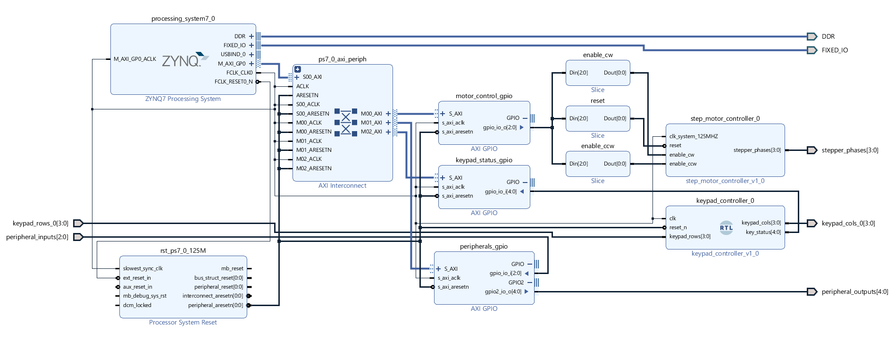
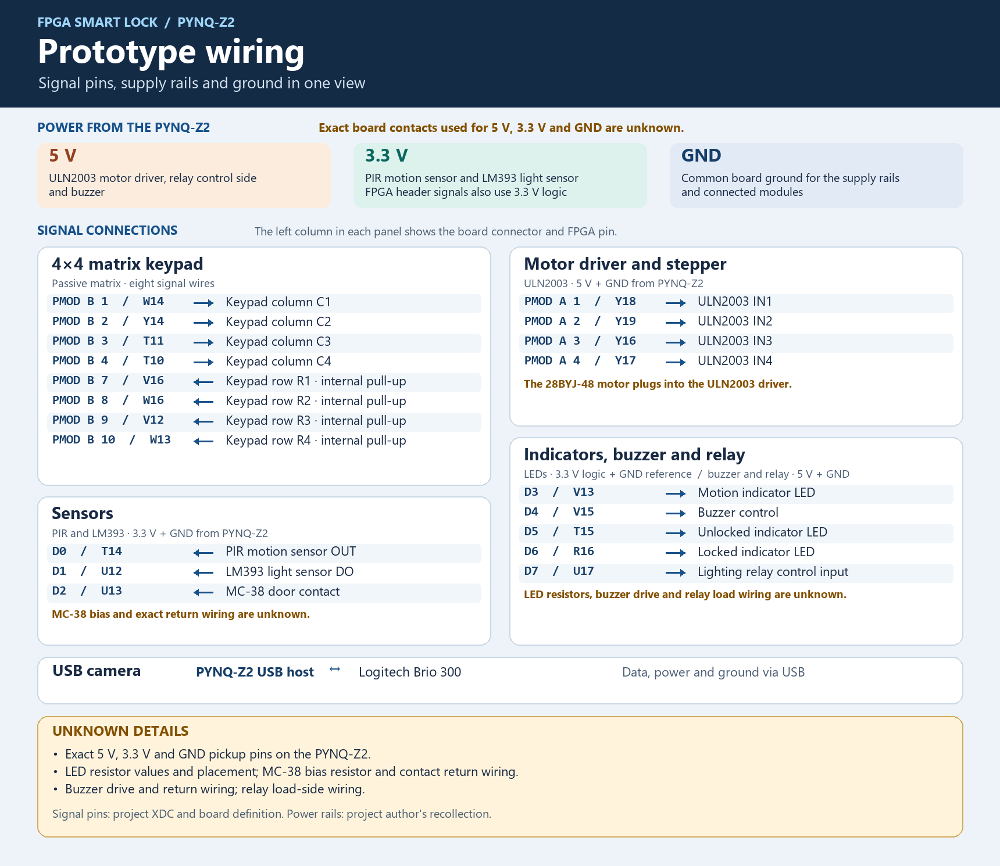

# PYNQ-Z2 FPGA Smart Lock

A final-year electrical engineering project built on the PYNQ-Z2. The prototype accepts a keypad code or uses a USB camera for face recognition. VHDL handles keypad scanning and stepper motor sequencing. A Python application reads the sensors, controls the lock, and can send Telegram alerts.

I tested the Smart Lock system on a physical PYNQ-Z2 board and confirmed that it works.

[Hardware and wiring](docs/hardware.md) · [PYNQ-Z2 setup](#run-the-application-on-pynq-z2) · [Prebuilt overlay](https://github.com/Subalo/pynq-z2-fpga-smart-lock/releases/tag/v1.0.0) · [Portfolio](https://subalo.github.io/portfolio-/#smart-lock)



## Design and verification

The Zynq processing system runs the Python application and communicates with the programmable logic through AXI GPIO. The door sensor lets the system track when the door closes so it can relock after an authorized opening.

- [Prototype photograph](docs/media/smart-lock-prototype.jpg) shows the PYNQ-Z2, USB camera, keypad, and breadboard peripherals.
- [Stepper simulation](docs/media/stepper-simulation.png) shows reset, direction enables, and the four motor phase signals. The [simulation folder](docs/simulation) contains additional captures.
- In Vivado Simulator 2019.1, the keypad testbench passed its assertions. The clock-divider, clockwise, counterclockwise, and integrated motor testbenches ran to their scheduled end without simulation errors.
- A clean Vivado 2019.1 build of the FPGA sources at [`033ff01`](https://github.com/Subalo/pynq-z2-fpga-smart-lock/commit/033ff01) produced the released overlay. Implementation reported zero DRC violations and zero routing errors. The configured timing constraints passed with a setup margin of 1.878 ns and a hold margin of 0.067 ns. The timing report also identified paths and I/O without assigned delay constraints.

[Project report (Hebrew)](https://subalo.github.io/portfolio-/assets/docs/smart-lock-report.pdf) · [Poster (Hebrew)](https://subalo.github.io/portfolio-/assets/docs/smart-lock-poster.pdf) · [Presentation (Hebrew)](https://subalo.github.io/portfolio-/assets/docs/smart-lock-presentation.pptx)

## Prototype wiring

[](docs/media/smart-lock-wiring.png)

Select the diagram to view it at full size. The [hardware guide](docs/hardware.md) records the connections and supply voltages from the builder's wiring list. See the [proposed low-voltage rebuild](docs/hardware.md#proposed-low-voltage-rebuild) for the reference connections and checks.

## Repository layout

| Path | Contents |
| --- | --- |
| `VHDL_03/smart_lock/` | Main Vivado project, block design, keypad RTL, and I/O constraints |
| `VHDL_03/step_motor_controller/` | Stepper sequencing, clock divider, packaged IP, and testbenches |
| `VHDL_03/KEYPADTESTNEW/` | Standalone keypad RTL and testbench |
| `VHDL_03/keypad_test/` | Keypad hardware test project |
| `VHDL_03/motor_gpio_direct_test/` | Direct GPIO motor hardware test project |
| `Python_04/` | PYNQ application notebook for the keypad, camera, lock actuator, and optional Telegram alerts |
| `docs/hardware.md` | Connector diagram, FPGA pin assignments, and prototype power and ground wiring |
| `docs/simulation/` | Simulation screenshots and a motor block diagram |

## Open the FPGA design

1. Clone this repository and open [smart_lock.xpr](VHDL_03/smart_lock/smart_lock.xpr) in **Vivado 2019.1**, the version used by the project. Install the **PYNQ-Z2** board definition and Zynq-7000 device support. The target part is `xc7z020clg400-1`.
2. Open `design_1` under **Sources**. The project references the packaged motor controller in the sibling `step_motor_controller` directory. If Vivado cannot resolve the custom IP, add that directory under **Settings → IP → Repository**.
3. Validate the block design and regenerate its output products. Run synthesis and implementation, then generate the bitstream for the board.
4. For behavioral simulation, open [step_motor_controller.xpr](VHDL_03/step_motor_controller/step_motor_controller.xpr) or [KEYPADTESTNEW.xpr](VHDL_03/KEYPADTESTNEW/KEYPADTESTNEW.xpr), choose the relevant testbench as the simulation top, and select **Run Behavioral Simulation**. Reference captures are in [docs/simulation](docs/simulation).

## Run the application on PYNQ-Z2

1. Boot the board with its PYNQ image and open Jupyter. Copy [FINAL_SMART_LOCK_SYSTEM.ipynb](Python_04/FINAL_SMART_LOCK_SYSTEM.ipynb) into a dedicated directory. The Python kernel needs `pynq`, `requests`, and an OpenCV build with `cv2.face.LBPHFaceRecognizer_create`. Connect the camera and peripherals using the [hardware wiring guide](docs/hardware.md).
2. Download both overlay files from the [v1.0.0 release](https://github.com/Subalo/pynq-z2-fpga-smart-lock/releases/tag/v1.0.0) and place them alongside the notebook. The prebuilt overlay lets you skip the Vivado build. Add the remaining files as described below.

   | File | Source |
   | --- | --- |
   | `design_1.bit` | [Download the prebuilt bitstream](https://github.com/Subalo/pynq-z2-fpga-smart-lock/releases/download/v1.0.0/design_1.bit). If rebuilding, copy `smart_lock.runs/impl_1/design_1_wrapper.bit` as `design_1.bit`. |
   | `design_1.hwh` | [Download the matching hardware handoff](https://github.com/Subalo/pynq-z2-fpga-smart-lock/releases/download/v1.0.0/design_1.hwh). If rebuilding, copy `smart_lock.srcs/sources_1/bd/design_1/hw_handoff/design_1.hwh` from the same build as the bitstream. Keep both files together with the same base name. |
   | `trainer.yml` | Use your own LBPH model or [train one locally](#create-the-local-face-model). The notebook loads this file during startup, even if you only intend to test the keypad. |
   | `haarcascade_frontalface_default.xml` | If the detector is absent from the board's OpenCV or PYNQ data directory, [download the detector XML from OpenCV](https://raw.githubusercontent.com/opencv/opencv/4.13.0/data/haarcascades/haarcascade_frontalface_default.xml) and place it beside the notebook. |

3. Create `smart_lock.local.json` in the same directory. Replace `SET_YOUR_CODE` with 1–8 digits, keeping the quotes so that leading zeros are preserved. Leave both Telegram fields empty to disable notifications. When enabled, Telegram alerts can include captured images sent to the configured chat.

   ```json
   {
     "keypad_code": "SET_YOUR_CODE",
     "telegram_bot_token": "",
     "telegram_chat_id": ""
   }
   ```

4. Open the notebook in Jupyter with its directory as the kernel's working directory. Check `Path.cwd()` if the notebook reports a missing local file. Run the setup cell, then the start cell. Wait for `System is ready.` before testing the keypad or camera. Stop the running cell to end the program. The access log and captured images are saved beside the notebook.

[PYNQ overlay documentation](https://pynq.readthedocs.io/en/latest/pynq_overlays/loading_an_overlay.html)

### Create the local face model

Save a few tightly cropped face photos of the person who will enroll, with their permission, as JPG files in `~/smart-lock-private/face-crops`. Run the following in a separate Python session with NumPy and OpenCV's `cv2.face` module, from the notebook directory. Label `1` matches the notebook's default `AUTHORIZED_USER_ID`.

```python
from pathlib import Path

import cv2
import numpy as np

photo_dir = Path.home() / "smart-lock-private" / "face-crops"
photos = sorted(photo_dir.glob("*.jpg"))
if not photos:
    raise FileNotFoundError(f"Add JPG face crops to {photo_dir}")

faces = [cv2.imread(str(photo), cv2.IMREAD_GRAYSCALE) for photo in photos]
if any(face is None for face in faces):
    raise ValueError("One or more face photos could not be read")

recognizer = cv2.face.LBPHFaceRecognizer_create()
recognizer.train(faces, np.full(len(faces), 1, dtype=np.int32))
recognizer.write("trainer.yml")
```

Keep the photos and trained model private. Test recognition under your own camera and lighting conditions before relying on the prototype. [OpenCV face recognizer API reference](https://github.com/opencv/opencv_contrib/blob/4.13.0/modules/face/include/opencv2/face/facerec.hpp)

## License

The project's original Python code, VHDL, testbenches, constraints, and written repository documentation are available under the [MIT License](LICENSE).

Third-party material retains its own terms and notices, including AMD/Xilinx IP and vendor-generated portions of the Vivado project files and HDL wrappers. The prebuilt overlay files, photos, figures, and linked report, poster, and presentation are outside this MIT grant.
