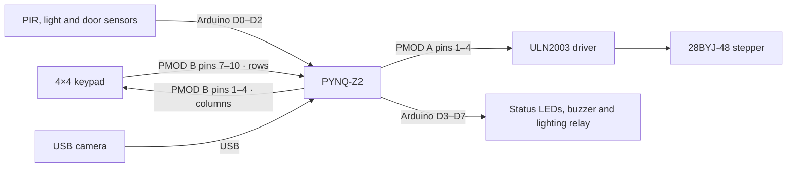
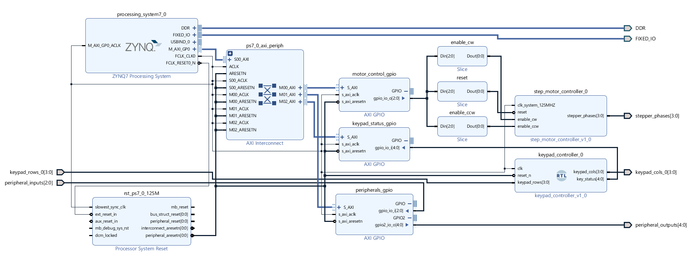

# Hardware and wiring

This map shows the signal connections for the PYNQ-Z2 prototype. The pin assignments come from the [project XDC](../VHDL_03/smart_lock/smart_lock.srcs/constrs_1/new/motor_pmod.xdc) and the board definition. The sensor and indicator roles follow the [application notebook](../Python_04/FINAL_SMART_LOCK_SYSTEM.ipynb) and the [project report, pp. 50–52](https://subalo.github.io/portfolio-/assets/docs/smart-lock-report.pdf#page=50).

The FPGA interfaces below use 3.3 V logic. Use the ULN2003 driver for the motor and a compatible interface for the relay or other loads. Check the supply and signal levels for your specific modules before connecting them. The diagram covers signal routing. For module power and ground, use the corresponding component documentation. [PYNQ-Z2 reference manual](https://www.mouser.com/datasheet/2/744/pynqz2_user_manual_v1_0-1525725.pdf)

## PMOD A and PMOD B

Pin numbers refer to the physical PMOD connector. Direction is relative to the PYNQ-Z2.

| Connector | FPGA pin | RTL signal | Direction | Peripheral |
| --- | --- | --- | --- | --- |
| PMOD A 1 | Y18 | `stepper_phases[0]` | Output | ULN2003 IN1 |
| PMOD A 2 | Y19 | `stepper_phases[1]` | Output | ULN2003 IN2 |
| PMOD A 3 | Y16 | `stepper_phases[2]` | Output | ULN2003 IN3 |
| PMOD A 4 | Y17 | `stepper_phases[3]` | Output | ULN2003 IN4 |
| PMOD B 1 | W14 | `keypad_cols_0[0]` | Output | Keypad column C1 |
| PMOD B 2 | Y14 | `keypad_cols_0[1]` | Output | Keypad column C2 |
| PMOD B 3 | T11 | `keypad_cols_0[2]` | Output | Keypad column C3 |
| PMOD B 4 | T10 | `keypad_cols_0[3]` | Output | Keypad column C4 |
| PMOD B 7 | V16 | `keypad_rows_0[0]` | Input with pull-up | Keypad row R1 |
| PMOD B 8 | W16 | `keypad_rows_0[1]` | Input with pull-up | Keypad row R2 |
| PMOD B 9 | V12 | `keypad_rows_0[2]` | Input with pull-up | Keypad row R3 |
| PMOD B 10 | W13 | `keypad_rows_0[3]` | Input with pull-up | Keypad row R4 |

## Arduino digital header

| Connector | FPGA pin | RTL signal | Direction | Peripheral |
| --- | --- | --- | --- | --- |
| D0 (AR0) | T14 | `peripheral_inputs[0]` | Input | PIR motion sensor |
| D1 (AR1) | U12 | `peripheral_inputs[1]` | Input | LM393 light sensor, digital output |
| D2 (AR2) | U13 | `peripheral_inputs[2]` | Input | MC-38 magnetic door sensor |
| D3 (AR3) | V13 | `peripheral_outputs[0]` | Output | Motion indicator LED |
| D4 (AR4) | V15 | `peripheral_outputs[1]` | Output | Buzzer control |
| D5 (AR5) | T15 | `peripheral_outputs[2]` | Output | Unlocked indicator LED |
| D6 (AR6) | R16 | `peripheral_outputs[3]` | Output | Locked indicator LED |
| D7 (AR7) | U17 | `peripheral_outputs[4]` | Output | Lighting relay control |

The notebook treats a low signal on AR2 as door closed and a high signal as door open. The XDC comment labels this input as an external reset. The final report and notebook assign it to the door sensor.

## Vivado block design

The AXI interconnect connects the Zynq processing system to three GPIO blocks. `keypad_status_gpio` carries the keypad state, `motor_control_gpio` drives the motor controller inputs, and `peripherals_gpio` carries the sensor inputs and indicator outputs.

