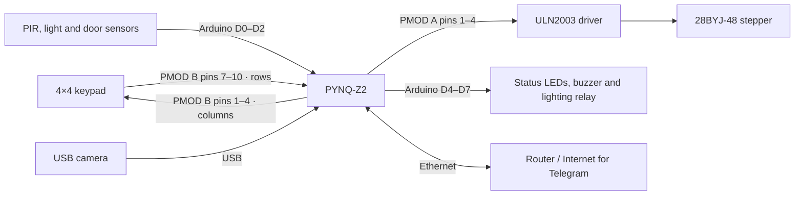
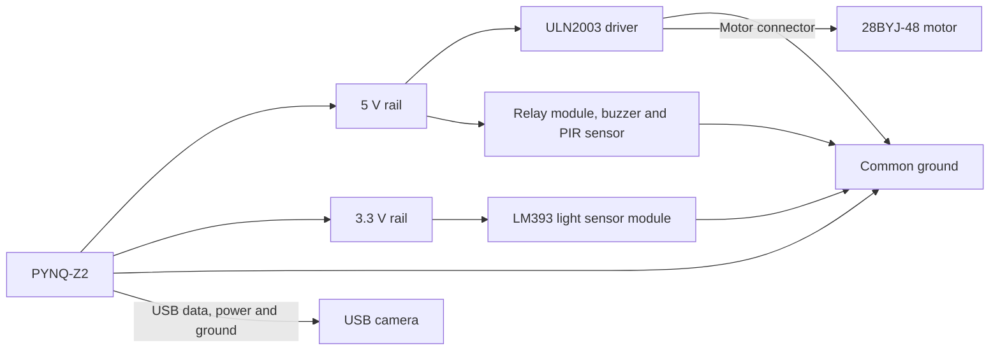

# Hardware and wiring

This map shows the signal connections for the PYNQ-Z2 prototype. The pin assignments come from the [project XDC](../VHDL_03/smart_lock/smart_lock.srcs/constrs_1/new/motor_pmod.xdc) and the board definition. The sensor and indicator roles follow the [application notebook](../Python_04/FINAL_SMART_LOCK_SYSTEM.ipynb) and the [project report, pp. 50–52](https://subalo.github.io/portfolio-/assets/docs/smart-lock-report.pdf#page=50).

## Power and ground

The prototype used the PYNQ-Z2 as the source for both supply rails and the common ground. The supply and peripheral connections below follow the builder's wiring list (section 6.2, table 17). The list specifies 5 V for the PIR sensor and 3.3 V for the LM393 module. It does not identify the exact board contacts used for power and ground.

| Component | Supply used | Ground or return |
| --- | --- | --- |
| ULN2003 motor driver | Board 5 V | Board GND |
| 28BYJ-48 stepper | Through the 5 V-powered ULN2003 driver module | Through the driver module and motor connector |
| Lighting relay module | Board 5 V on the module's control side | Board GND on the module's control side. Load-side wiring was not recorded. |
| Buzzer | Board 5 V | Board GND reference. The exact drive and return wiring was not recorded. |
| PIR motion sensor | Board 5 V | Board GND |
| LM393 light sensor module | Board 3.3 V | Board GND |
| Green unlocked LED and red locked LED | 3.3 V logic on D5 and D6 | Return through a resistor to board GND. The resistor values were not recorded. |
| MC-38 magnetic door sensor | Passive contact. D2 uses the 3.3 V logic domain. | The exact switch-to-GND connection and bias resistor arrangement were not recorded. |
| 4×4 matrix keypad | Passive row and column matrix on PMOD B | Uses the eight matrix signal wires. The XDC enables FPGA pull-ups on the row inputs. |
| Logitech Brio 300 camera | PYNQ-Z2 USB host port | Through the USB cable |
| Optional Telegram alerts | Board Ethernet port to a router with internet access | Network connection only |

The FPGA header signals use 3.3 V logic, including the control signals to the 5 V peripherals. Check the signal levels and interfaces of the specific modules before recreating the circuit. [PYNQ-Z2 reference manual](https://dpoauwgwqsy2x.cloudfront.net/Download/pynqz2_user_manual_v1_0.pdf)

## PMOD A and PMOD B

Pin numbers refer to the physical PMOD connector. Direction is relative to the PYNQ-Z2.

| Connector | FPGA pin | RTL signal | Direction | Peripheral |
| --- | --- | --- | --- | --- |
| PMOD A 1 | Y18 | `stepper_phases[0]` | Output | ULN2003 IN1 |
| PMOD A 2 | Y19 | `stepper_phases[1]` | Output | ULN2003 IN2 |
| PMOD A 3 | Y16 | `stepper_phases[2]` | Output | ULN2003 IN3 |
| PMOD A 4 | Y17 | `stepper_phases[3]` | Output | ULN2003 IN4 |
| PMOD B 1 | W14 | `keypad_cols_0[0]` | Output | Keypad column C1 |
| PMOD B 2 | Y14 | `keypad_cols_0[1]` | Output | Keypad column C2 |
| PMOD B 3 | T11 | `keypad_cols_0[2]` | Output | Keypad column C3 |
| PMOD B 4 | T10 | `keypad_cols_0[3]` | Output | Keypad column C4 |
| PMOD B 7 | V16 | `keypad_rows_0[0]` | Input with pull-up | Keypad row R1 |
| PMOD B 8 | W16 | `keypad_rows_0[1]` | Input with pull-up | Keypad row R2 |
| PMOD B 9 | V12 | `keypad_rows_0[2]` | Input with pull-up | Keypad row R3 |
| PMOD B 10 | W13 | `keypad_rows_0[3]` | Input with pull-up | Keypad row R4 |

## Arduino digital header

| Connector | FPGA pin | RTL signal | Direction | Peripheral |
| --- | --- | --- | --- | --- |
| D0 (AR0) | T14 | `peripheral_inputs[0]` | Input | PIR motion sensor |
| D1 (AR1) | U12 | `peripheral_inputs[1]` | Input | LM393 light sensor, digital output |
| D2 (AR2) | U13 | `peripheral_inputs[2]` | Input | MC-38 magnetic door sensor |
| D3 (AR3) | V13 | `peripheral_outputs[0]` | Output | Motion indicator in the XDC and notebook. The supplied wiring list does not show a connected LED on D3. |
| D4 (AR4) | V15 | `peripheral_outputs[1]` | Output | Buzzer control |
| D5 (AR5) | T15 | `peripheral_outputs[2]` | Output | Green unlocked indicator LED |
| D6 (AR6) | R16 | `peripheral_outputs[3]` | Output | Red locked indicator LED |
| D7 (AR7) | U17 | `peripheral_outputs[4]` | Output | Lighting relay control |

The notebook treats a low signal on AR2 as door closed and a high signal as door open. The XDC comment labels this input as an external reset. The final report and notebook assign it to the door sensor.

## Proposed low-voltage rebuild

This is a reference wiring plan for rebuilding the prototype with the same FPGA signal assignments and supply voltages. The pickup points, resistor values, and module interfaces below are proposed choices. The assembled prototype is no longer available to verify those details, and this plan has not been bench-tested.

### Board supply connections

| Rail | Proposed board connection |
| --- | --- |
| 5 V | Raspberry Pi header, physical pin 2 |
| 3.3 V | Arduino power header J7, pin 5 (`3V3`) |
| Common GND | Arduino power header J7, pin 3 (`GND`) |

Locate pin 1 and verify the rail voltages with a meter before attaching modules. Check that the board power source and headers can supply the combined motor, camera, buzzer, relay, and sensor current with margin. Keep the two positive rails separate. All FPGA signal lines remain in the 3.3 V logic domain. [PYNQ-Z2 reference manual, tables 15, 18 and 22](https://dpoauwgwqsy2x.cloudfront.net/Download/pynqz2_user_manual_v1_0.pdf)

### Peripheral connections

| Peripheral | Proposed wiring |
| --- | --- |
| ULN2003 driver and 28BYJ-48 | Use the 5 V version of the motor. Connect the driver's 5 V and GND terminals to the corresponding rails. Connect PMOD A pins 1–4 to IN1–IN4 as listed above, and plug the motor into the driver's motor connector. Select a driver module that specifies compatibility with 3.3 V control and includes the motor flyback path. |
| 4×4 keypad | Connect columns C1–C4 to PMOD B pins 1–4 and rows R1–R4 to pins 7–10. Use a passive matrix keypad with no separate supply connection. Match wires by row and column, since ribbon pin order can vary. |
| PIR sensor | Connect VCC to 5 V and GND to common GND. The notebook expects a high signal on motion at D0. Verify the module's OUT voltage before connecting it. A 5 V output requires a suitable 5 V-to-3.3 V interface before D0. |
| LM393 light sensor | With a module rated for a 3.3 V supply, connect VCC to 3.3 V, GND to common GND, and digital output to D1. Verify that the output stays in the 3.3 V domain and goes high in the dark for the notebook's default `DARK_VALUE = 1`. Add a 10 kΩ pull-up to 3.3 V only if the output is open collector and the module lacks an onboard pull-up. |
| MC-38 door contact | Connect a 10 kΩ pull-up from D2 to 3.3 V. Connect the contact between D2 and GND. With the magnet in the door-closed position, confirm that the contact conducts so the input reads low, matching `DOOR_CLOSED_VALUE = 0`. |
| Green and red LEDs | Connect the green LED anode to D5 and the red LED anode to D6. Connect each cathode through its own 470 Ω series resistor to GND. Use indicator LEDs with a forward voltage suitable for a 3.3 V output. D3 can drive an optional motion LED via the same circuit. |
| Buzzer | Use a 5 V, externally driven buzzer module with an onboard driver and a 3.3 V-compatible active-high signal input. Connect VCC to 5 V, GND to common GND, and signal to D4. Select a module that accepts the notebook's nominal 3 kHz tone signal. |
| Lighting relay | Use a 5 V relay module with an onboard coil driver, flyback protection, and a 3.3 V-compatible active-high input. Connect VCC to 5 V, GND to common GND, and IN to D7. For a low-voltage bench demonstration, connect a current-limited 5 V source to COM, NO to the positive terminal of a rated 5 V lamp, and the lamp return to that source's ground. Keep the load supply separate from the board's 5 V rail. |
| USB camera | Plug the camera into the PYNQ-Z2 USB host port. The cable carries data, power, and ground. |
| Optional Telegram alerts | Connect the PYNQ-Z2 Ethernet port to a router with internet access and configure the notebook's local Telegram settings. |

Before attaching the motor or lamp, check the D0–D2 logic levels, verify that each LED follows its output, and confirm that the buzzer and relay remain off at a low input. Check the exact module pinouts against their datasheets. [Texas Instruments ULN2003A reference](https://www.ti.com/product/ULN2003A)

## Vivado block design

The AXI interconnect connects the Zynq processing system to three GPIO blocks. `keypad_status_gpio` carries the keypad state, `motor_control_gpio` drives the motor controller inputs, and `peripherals_gpio` carries the sensor inputs and indicator outputs.

